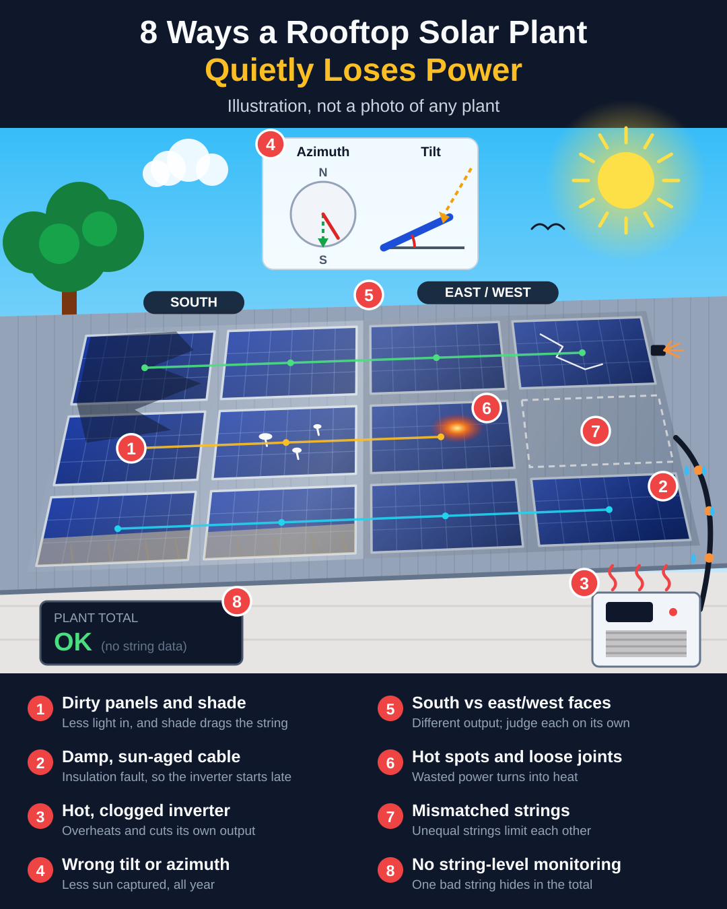
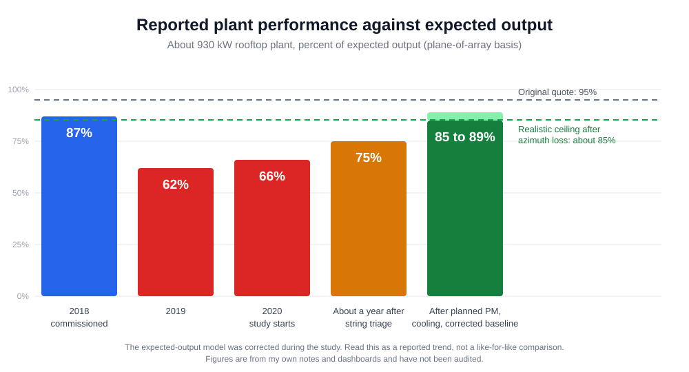

# Rooftop solar O&M case study

How I took a neglected rooftop solar plant from about 66% of expected output back to 85 to 89%, what I found on the way,
and the small tools I wrote to make the checks repeatable.

The plant is about 930 kW, commissioned in 2018, in the monsoon belt of Western India. It belonged to a previous
employer. I'm not naming the company or the site. All figures come from my own notes and dashboards and have not been
independently audited.



## Result

| Stage | Reported performance against expected output |
|---|---|
| 2018, commissioning | about 87% |
| 2019 | about 62% |
| 2020, when I started studying it | about 66% |
| About a year after string triage | about 75% |
| After planned PM, cooling and a corrected baseline | 85 to 89% |

Annual generation is now 13 to 16 lakh kWh. No inverter has failed since the incident year and no string has been
disconnected again.

The maintenance contract costs about 7 lakh rupees a year. At 15 rupees a unit it pays for itself if it recovers about
46,700 units a year, roughly 3% of what the plant generates. See [docs/09](docs/09-cost-and-savings.md).

The expected-output model was corrected during the study, so treat the table as a trend rather than a like-for-like
comparison. See [docs/04](docs/04-azimuth-and-expected-output.md).



## What I found

- Cleaning had no plan and there was no preventive maintenance.
- Inverters overheated in summer.
- Unresolved string faults came before inverter failures.
- Wet-weather insulation problems made strings start late in the morning.
- The original quote of 95% could never be met: the panels face west instead of south, which costs about 10%.
- The rainy-season grid cut generation, which is an availability loss and not a plant fault.
- Thermography added little on this plant. I tried it, and now do it about once a year or when there is a reason.

The full write-up is in [docs/01-case-study.md](docs/01-case-study.md) and
[docs/02-findings.md](docs/02-findings.md).

## Tools

Plain Python. The core tools use only the standard library. The azimuth estimate uses `pvlib`.

```
pip install -r requirements.txt
python -m tools.make_sample_data
pytest -q
```

**Late string pickup.** Flags strings that start late or not at all, compared with their peers on the same inverter.

```
$ python -m tools.string_pickup data/sample/string_currents.csv
inverter  string  late days  never started  avg delay (min)  last date
INV-2     S07     4/5        4              -                2025-06-10
INV-1     S05     5/5        0              45               2025-06-10
```

**Inverter risk.** Ranks inverters by how many string faults are still open.

```
$ python -m tools.inverter_risk data/sample/fault_log.csv --as-of 2025-06-10
inverter  risk    open  oldest open (days)  faults in last 180 d
INV-1     HIGH    3     120                 3
INV-2     MEDIUM  1     6                   3
INV-3     LOW     0     0                   1
```

**Cleaning gain.** Performance ratio before and after each cleaning, using clear days only.

```
$ python -m tools.cleaning_gain data/sample/daily_energy.csv data/sample/cleaning_dates.csv --kwp 930
cleaning    PR before  PR after   gain (points)  gain (relative)
2025-05-16      78.6 %     80.7 %         2.11   2.69 %
2025-05-31      79.4 %     80.7 %         1.26   1.58 %
```

**Performance ratio.**

```
$ python -m tools.pr --kwp 930 --ac-kwh 100000 --poa-kwh-m2 150 --target-pr 0.85
performance ratio    71.7 %
expected at 85%       118575 kWh
shortfall             18575 kWh
```

**Azimuth penalty.** A clear-sky, relative estimate. See [docs/04](docs/04-azimuth-and-expected-output.md).

**Savings.** Contract cost against units recovered, with a break-even. See [docs/09](docs/09-cost-and-savings.md).

```
$ python -m tools.savings --amc 700000 --annual-kwh 1450000 --pr-now 0.87 --pr-before 0.66 --tariff 10 15 17
  tariff  break-even units  share of generation  value of recovered  net of contract  benefit/cost
   Rs 10            70,000                 4.8%         ₹35.00 lakh      ₹28.00 lakh          5.0x
   Rs 15            46,667                 3.2%         ₹52.50 lakh      ₹45.50 lakh          7.5x
   Rs 17            41,176                 2.8%         ₹59.50 lakh      ₹52.50 lakh          8.5x
```

The data in `data/sample/` is synthetic. The thresholds are from one plant and need tuning for yours.

## Repo layout

```
docs/        case study, findings, string triage, azimuth, SCADA, maintenance plan, 27-item loss register,
             losses beyond the register, cost and savings
tools/       the Python tools above
tests/       pytest suite
templates/   fault register, cleaning log, thermography log, insulation resistance log, PM calendar
data/sample/ synthetic data for the examples and tests
assets/      charts and illustration
```

## How the numbers are defined

Performance ratio is final yield divided by reference yield. Final yield is AC energy divided by installed DC capacity.
Reference yield is plane-of-array energy divided by 1 kW/m2. The percentages in the timeline are performance against
expected output on a plane-of-array basis. State your own metric and baseline before you compare periods.

## Safety

PV DC circuits can stay live in daylight. Nothing here replaces a method statement, a risk assessment, the maker's
instructions or a statutory requirement. Only qualified people should test insulation resistance, open enclosures or
inspect live equipment.

## Licence

MIT. See [LICENSE](LICENSE).

By Pratik R. Kadam
