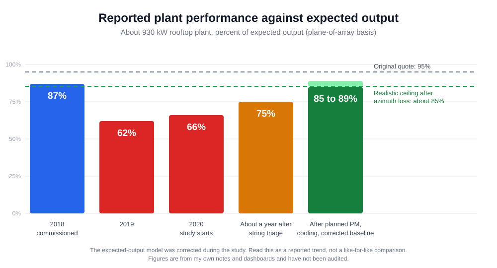

# Case study: bringing a neglected rooftop plant back

## Context

An industrial rooftop solar plant of about 930 kW, commissioned in 2018, at a site in the monsoon belt of
Western India. I started studying it in 2020. I wanted to understand how a plant like this really behaves,
beyond the commissioning papers, so I walked it, read the data every day and kept notes. The plant belonged to
a previous employer. I'm not naming the company or the site.

## Where it started

- Panel cleaning had no plan. It happened about once a month, then about once in two months.
- There was no cable maintenance and no preventive maintenance routine at all.
- In summer the inverters were overloaded and ran hot.
- String maintenance that should have happened before summer was not carried out.
- I lost inverters. In one case a connector had gone to ground.
- Before an inverter failed, its history showed several string faults that nobody had cleared. A few months after
  the pile-up, it burned out.
- In the rainy season the grid in that area is unreliable, with power failures. Generation drops with it, and
  that has nothing to do with the plant's condition.

## Timeline

| When | Reported performance against expected output | What was going on |
|---|---|---|
| 2018 | about 87% | Commissioning |
| 2019 | about 62% | Attributed to the COVID period |
| 2020 | about 66% | Still down. I started studying the plant |
| About a year after string triage | about 75% | Removing faulty strings protected the inverters |
| After planned PM, cooling and a corrected baseline | 85 to 89% | See below |

## What I did, in order

1. **String triage.** With little manpower, I used the daily dashboard to see which strings picked up late in the
   morning. I took the worst ones out, looked for an open connection or water collecting near the connector, fixed
   it and reconnected. This cost generation in the short term. It saved the inverters. See
   [string triage](03-string-triage.md).
2. **Planned maintenance.** Scheduled cleaning, cable and connector checks, and a thorough inspection of the whole
   plant. I also tried thermography, which added little (see the maintenance plan). See [maintenance plan](06-maintenance-plan.md).
3. **Fixing the baseline.** The expected-output figure was wrong. The original quote said 95%, but the array could
   never reach it. About 10% was lost to azimuth: because of spacing, the panels were installed facing west instead
   of south. Recalculating gave the plant a realistic ceiling of about 85%. See
   [azimuth and expected output](04-azimuth-and-expected-output.md).
4. **Inverter cooling.** I added cooling units so the inverters could run healthy through summer.
5. **Monitoring.** I upgraded the solar SCADA so it gives a pre-indication of a fault. Someone who doesn't know solar
   well can still act on it, because each fault has already been identified and mapped to an action. See
   [SCADA pre-indication](05-scada-pre-indication.md).

## Results

- Performance against plane-of-array expected output is now about 85 to 89%.
- Annual generation is now 13 to 16 lakh kWh.
- No inverter has failed since the incident year, and no string has been disconnected again.

## What I would do earlier next time

- Check the azimuth and the expected-output model in the first month, before chasing individual faults.
- Treat repeated unresolved string faults on one inverter as an urgent ticket, not background noise.
- Start the daily late-pickup review on day one.

## Limits

These are my own figures from my notes and dashboards. They have not been independently audited. The expected-output
model was corrected partway through, so the early and late percentages may not sit on the same baseline. Treat the
timeline as a reported trend. The thresholds in the tools come from one plant and need tuning for yours.
